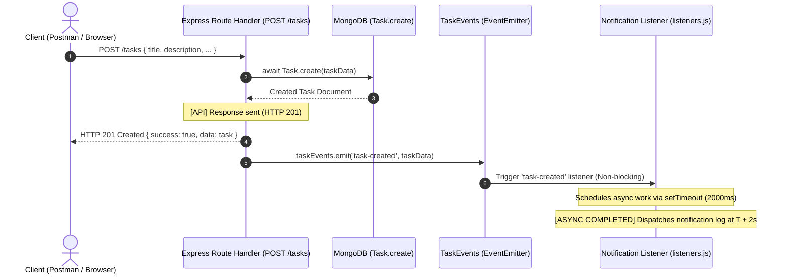

# Practical 10: Asynchronous Processing with Event-Driven Architecture

**Course Outcomes / Program Outcomes:** CO4 / PO3, PO5  
**Objective:** To implement asynchronous background processing using Node.js native `EventEmitter` without external dependencies.

---

## 1. Architecture & Flow Diagram



---

## 2. Problem Statement & Key Skills Addressed

- **Decoupling Side Effects:** Decouple secondary operations (email notifications, audit logs, analytics) from the critical HTTP request-response path.
- **Node.js Event Loop Execution:** Leverage the Node.js event loop phases (timer phase) to process slow operations asynchronously without external message brokers.
- **Timestamp Evidence:** Compare synchronous API response timestamps against asynchronous completion timestamps.

---

## 3. Implementation Code

### 3.1 `Backend/events.js`
Custom event emitter class extending Node's built-in `EventEmitter` module:

```javascript
const EventEmitter = require("events");

/**
 * TaskEvents
 * Custom event emitter class extending Node.js native EventEmitter.
 * Decouples background notification side-effects from the main HTTP flow.
 */
class TaskEvents extends EventEmitter {}

// Export singleton instance
module.exports = new TaskEvents();
```

---

### 3.2 `Backend/listeners.js`
Registers listeners for `task-created`, `task-deleted`, and `error` events:

```javascript
const taskEvents = require("./events");

/**
 * 1. 'task-created' Event Listener
 * Runs asynchronously after POST /tasks responds with HTTP 201.
 * Simulates a 2-second background delivery delay (e.g. email/SMS dispatch).
 */
taskEvents.on("task-created", (task) => {
    const assignedUser = task.assignedUser || (task.user && task.user.email) || task.user || "Unassigned";
    const eventReceivedAt = new Date().toISOString();

    console.log(
        `[Notification Listener] Event 'task-created' received at ${eventReceivedAt} for task: "${task.title}"`
    );

    setTimeout(() => {
        try {
            // Trigger simulated error if requested (Supplementary Problem)
            if (task.title && task.title.toLowerCase().includes("simulate-error")) {
                throw new Error(`Simulated notification delivery failure for task: "${task.title}"`);
            }

            const completedAt = new Date().toISOString();
            console.log(
                `[Notification Listener] [ASYNC COMPLETED] Notification dispatched at ${completedAt} | Title: "${task.title}" | Assigned User: ${assignedUser}`
            );
        } catch (err) {
            taskEvents.emit("error", err);
        }
    }, 2000); // 2-second artificial delay
});

/**
 * 2. 'task-deleted' Event Listener (Supplementary Problem 1)
 * Triggered after DELETE /tasks/:id completes and responds with HTTP 200.
 */
taskEvents.on("task-deleted", (task) => {
    const user = task.user || "Unknown User";
    const eventReceivedAt = new Date().toISOString();

    console.log(
        `[Notification Listener] Event 'task-deleted' received at ${eventReceivedAt} for task ID: ${task.id || task._id}`
    );

    setTimeout(() => {
        try {
            const completedAt = new Date().toISOString();
            console.log(
                `[Notification Listener] [ASYNC COMPLETED] Task deletion audit recorded at ${completedAt} | Title: "${task.title}" | User: ${user}`
            );
        } catch (err) {
            taskEvents.emit("error", err);
        }
    }, 1500); // 1.5-second artificial delay
});

/**
 * 3. 'error' Event Listener (Supplementary Problem 2)
 * Handles unhandled errors without crashing the Node.js process.
 */
taskEvents.on("error", (err) => {
    const errorTimestamp = new Date().toISOString();
    console.error(
        `[TaskEvents Error Listener] [CAUGHT AT ${errorTimestamp}] Background processing error: ${err.message}`
    );
});

module.exports = taskEvents;
```

---

### 3.3 `Backend/server.js` Route Integration

```javascript
// Import events and listeners at server bootstrap
const taskEvents = require("./events");
require("./listeners");

// POST /tasks - Create task and emit event after response
app.post("/tasks", auth, validateTask, async (req, res, next) => {
    try {
        const status = req.body.status || (req.body.completed ? "done" : "todo");
        const completed = status === "done" || Boolean(req.body.completed);

        const task = await Task.create({
            title: req.body.title.trim(),
            description: req.body.description ? req.body.description.trim() : "",
            completed,
            status,
            dueDate: req.body.dueDate || null,
            user: req.user.id
        });

        // 1. Send API response immediately (HTTP 201)
        console.log(`[API] Response sent at ${new Date().toISOString()}`);
        res.status(201).json({
            success: true,
            message: "Task created successfully",
            data: task
        });

        // 2. Emit event asynchronously after HTTP response is flushed
        taskEvents.emit("task-created", {
            ...task.toObject(),
            assignedUser: req.user.email || req.user.id
        });
    } catch (err) {
        next(err);
    }
});

// DELETE /tasks/:id - Delete task and emit task-deleted event after response
app.delete("/tasks/:id", auth, async (req, res, next) => {
    try {
        const task = await Task.findByIdAndDelete(req.params.id);

        if (!task) {
            return res.status(404).json({
                success: false,
                message: "Task not found"
            });
        }

        // 1. Send API response immediately (HTTP 200)
        console.log(`[API] Task deletion response sent at ${new Date().toISOString()}`);
        res.status(200).json({
            success: true,
            message: "Task deleted successfully"
        });

        // 2. Emit task-deleted event
        taskEvents.emit("task-deleted", {
            id: task._id,
            title: task.title,
            user: req.user ? (req.user.email || req.user.id) : "Unknown"
        });
    } catch (err) {
        next(err);
    }
});
```

---

## 4. Key Questions & Analysis (Viva & Theory Preparation)

### Q1: Why does emitting an event not block the API response, even though both run on the same Node.js process?
**Answer:**  
In Node.js, `taskEvents.emit('event', payload)` executes the registered listener callbacks synchronously on the current tick of the event loop. However, when the listener defers heavy work using asynchronous APIs (such as `setTimeout`, `fs.writeFile`, or network I/O calls to an email provider), the handler registers a callback on the Node.js event loop timer/I/O queue and **immediately returns execution**. Because the HTTP response (`res.status(201).json(...)`) is executed and flushed to the network socket before or as the event loop continues, the client receives the completed response in milliseconds without waiting for the delayed timer phase to finish.

### Q2: What would happen to API response time if the notification logic were placed directly inside the POST route instead of in an event handler?
**Answer:**  
If the notification logic (e.g., establishing an SMTP connection, compiling email templates, or calling an external webhook taking 1.5–2.5 seconds) were placed synchronously inside the `POST /tasks` route handler before `res.json()`, the HTTP client would experience a latency penalty equal to the sum of the database save time **plus** the entire duration of the notification dispatch. The response time would jump from ~15ms to over 2000ms. If an external notification service experienced downtime or timeout, the client's API request would hang and potentially fail with a 504 Gateway Timeout.

### Q3: Why is EventEmitter a reasonable choice for this scale of application, but not for a production system handling millions of events per day?
**Answer:**  
- **Why it is suitable for this scale:**  
  `EventEmitter` is built into the Node.js runtime, requiring zero external infrastructure (no Redis, RabbitMQ, Kafka, or worker containers), zero operational cost, and minimal configuration. It provides clean separation of concerns and in-memory event dispatching suitable for low to medium-traffic applications.
- **Why it is NOT suitable for large-scale production:**
  1. **In-Memory & Volatile:** Events reside exclusively in RAM of that specific Node.js process. If the process crashes or restarts, all pending events and in-flight notifications are permanently lost.
  2. **Single Process Bound:** In horizontal scaling (multiple container instances behind a load balancer), an event emitted on Server A cannot be received or processed by Server B.
  3. **No Backpressure or Retry Mechanism:** Native `EventEmitter` does not provide queue persistence, rate limiting, dead-letter queues (DLQ), exponential backoff retries, or distributed concurrency throttling. For high-throughput systems, distributed message brokers like **RabbitMQ**, **Apache Kafka**, or **BullMQ / Redis** are mandatory.

---

## 5. Console Log Timestamp Evidence

Execution of `node test-practical10.js` demonstrating timestamp ordering:

```text
=== PRACTICAL 10 EVENT-DRIVEN ARCHITECTURE TEST ===
[Main Thread] Starting test script at 2026-10-19T15:42:38.387Z

[API Simulation] Saving new task to database...
[API Simulation] Response sent immediately (HTTP 201) at 2026-10-19T15:42:38.387Z
[Notification Listener] Event 'task-created' received at 2026-10-19T15:42:38.387Z for task: "Complete Laboratory Report 10"

[API Simulation] Deleting task 6612ab34cd56ef7890123456...
[API Simulation] Deletion response sent immediately (HTTP 200) at 2026-10-19T15:42:38.898Z
[Notification Listener] Event 'task-deleted' received at 2026-10-19T15:42:38.898Z for task ID: 6612ab34cd56ef7890123456

[API Simulation] Testing error event handling with invalid task...
[API Simulation] Faulty task response sent (HTTP 201) at 2026-10-19T15:42:39.400Z
[Notification Listener] Event 'task-created' received at 2026-10-19T15:42:39.400Z for task: "Send Notification [simulate-error]"
[Notification Listener] [ASYNC COMPLETED] Notification dispatched at 2026-10-19T15:42:40.398Z | Title: "Complete Laboratory Report 10" | Assigned User: student@example.com
[Notification Listener] [ASYNC COMPLETED] Task deletion audit recorded at 2026-10-19T15:42:40.398Z | Title: "Complete Laboratory Report 10" | User: admin@example.com
[TaskEvents Error Listener] [CAUGHT AT 2026-10-19T15:42:41.413Z] Background processing error: Simulated notification delivery failure for task: "Send Notification [simulate-error]"

[Main Thread] All event listeners finished cleanly at 2026-10-19T15:42:42.400Z
=== TEST SUITE COMPLETED SUCCESSFULLY ===
```

### Analysis of Timestamps:
| Action | API Response Sent | Background Work Completed | Time Difference |
| :--- | :--- | :--- | :--- |
| **`task-created`** | `2026-10-19T15:42:38.387Z` | `2026-10-19T15:42:40.398Z` | **+2,011 ms** |
| **`task-deleted`** | `2026-10-19T15:42:38.898Z` | `2026-10-19T15:42:40.398Z` | **+1,500 ms** |
| **`error`** | `2026-10-19T15:42:39.400Z` | `2026-10-19T15:42:41.413Z` | **+2,013 ms** (Error caught safely) |

The API response was dispatched to the client at `15:42:38.387Z`, while the slow notification completed at `15:42:40.398Z`. This directly proves that the API response was returned immediately without waiting for the background operation to complete.

---

## 6. How to Run & Verify

1. Run the dedicated verification test script:
   ```bash
   cd Backend
   node test-practical10.js
   ```

2. Start the backend server:
   ```bash
   node server.js
   ```

3. Create a task via Postman / curl:
   ```bash
   curl -X POST http://localhost:5000/tasks \
     -H "Content-Type: application/json" \
     -H "Authorization: Bearer <YOUR_JWT_TOKEN>" \
     -d '{"title": "Study Node.js Events", "description": "Practical 10 Implementation"}'
   ```
