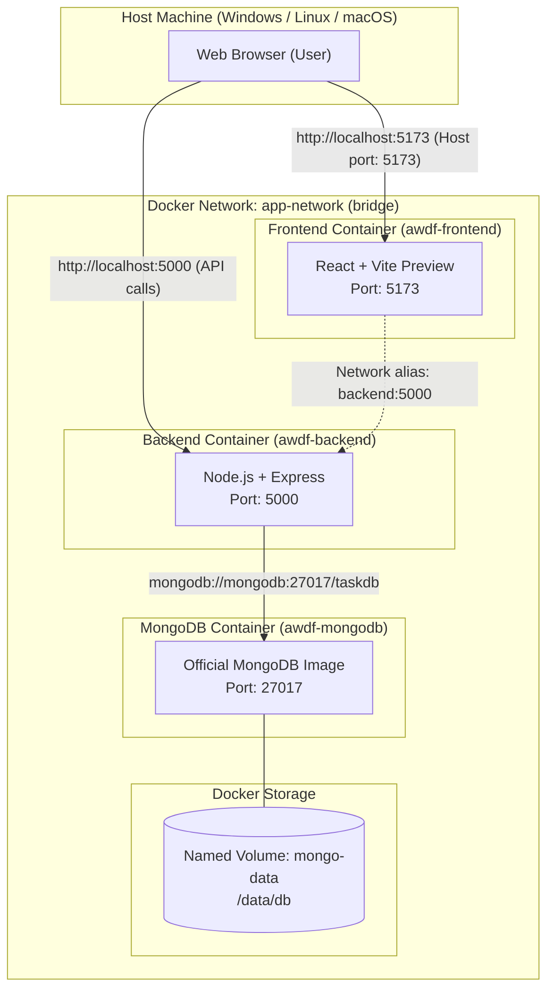

# Practical 11: Containerization with Docker and Docker Compose

**Course Outcomes / Program Outcomes:** CO5 / PO3, PO5  
**Objective:** To containerize the full-stack application using Docker and orchestrate services using Docker Compose.

---

## 1. Architecture & Network Topology



---

## 2. Docker Artifacts Implemented

### 2.1 Backend Dockerfile (`Backend/Dockerfile`)
```dockerfile
# Practical 11: Backend Containerization (Node.js/Express)
FROM node:18-alpine

WORKDIR /app

# Cache package manifests for efficient layer caching
COPY package*.json ./
RUN npm install

# Copy application source files
COPY . .

# Expose Express server port
EXPOSE 5000

# Start backend server
CMD ["node", "server.js"]
```

### 2.2 Frontend Dockerfile (`Frontend/Dockerfile`)
```dockerfile
# Practical 11: Frontend Containerization (React + Vite)
# Multi-stage build pattern
FROM node:18-alpine AS build

WORKDIR /app

# Cache package manifests for efficient layer caching
COPY package*.json ./
RUN npm install

# Copy source code and build production bundle
COPY . .
RUN npm run build

# Expose Vite preview port
EXPOSE 5173

# Serve built production assets bound to all network interfaces (0.0.0.0)
CMD ["npm", "run", "preview", "--", "--host", "0.0.0.0", "--port", "5173"]
```

### 2.3 Docker Ignore Files (Supplementary Problem 1)
- **`Backend/.dockerignore`**: Excludes `node_modules`, `npm-debug.log`, `.env`, and git metadata from the build context.
- **`Frontend/.dockerignore`**: Excludes `node_modules`, `dist`, `.env*`, and temporary files from the build context.

### 2.4 Multi-Container Orchestration (`docker-compose.yml`)
```yaml
version: '3.8'

services:
  # Frontend Service (React / Vite)
  frontend:
    build:
      context: ./Frontend
      dockerfile: Dockerfile
    container_name: awdf-frontend
    ports:
      - "5173:5173"
    environment:
      - VITE_API_URL=http://localhost:5000
    depends_on:
      - backend
    networks:
      - app-network
    restart: unless-stopped

  # Backend Service (Node.js / Express)
  backend:
    build:
      context: ./Backend
      dockerfile: Dockerfile
    container_name: awdf-backend
    ports:
      - "5000:5000"
    environment:
      - PORT=5000
      - MONGO_URI=mongodb://mongodb:27017/taskdb
      - JWT_SECRET=supersecret_jwt_key_practical11_awdf
    depends_on:
      - mongodb
    networks:
      - app-network
    restart: unless-stopped

  # Database Service (MongoDB)
  mongodb:
    image: mongo:latest
    container_name: awdf-mongodb
    ports:
      - "27017:27017"
    volumes:
      - mongo-data:/data/db
    networks:
      - app-network
    restart: unless-stopped

# Named Volumes (Data Persistence)
volumes:
  mongo-data:
    driver: local

# Bridge Network (Inter-service Communication)
networks:
  app-network:
    driver: bridge
```

---

## 3. Key Questions & Analysis (Viva & Theory Preparation)

### Q1: Why does the backend container need to reference the MongoDB container by its service name (e.g., `mongodb`) rather than `localhost`?
**Answer:**  
In Docker, each container operates in its own isolated network namespace with its own loopback interface (`127.0.0.1` / `localhost`). If the backend container attempts to connect to `mongodb://localhost:27017`, it is querying its own container's network stack where MongoDB is not running, causing a `connection refused` error.  
When services belong to a user-defined bridge network in Docker Compose (e.g., `app-network`), Docker provides an automatic **embedded DNS server** (127.0.0.11). It resolves the service name (e.g., `mongodb` or `backend`) directly to the container's internal private IP address on that network.

### Q2: What is the difference between `EXPOSE` in a Dockerfile and the `ports` mapping in `docker-compose.yml`?
**Answer:**  
- **`EXPOSE` (Documentation & Internal declaration):**  
  `EXPOSE 5000` inside a `Dockerfile` serves as documentation and signals to the Docker engine that the container listens on port 5000. It **does not** publish or bind the port to the host machine. Other containers on the same network can access it, but the host machine's browser cannot.
- **`ports` (Host to Container Port Forwarding):**  
  The `ports: - "5000:5000"` configuration in `docker-compose.yml` actively binds port 5000 on the host machine to port 5000 of the container. This creates an ingress firewall rule, allowing external web browsers and tools (Postman, curl) to reach the service via `http://localhost:5000`.

### Q3: Why is it considered bad practice to copy `node_modules` into a Docker image instead of running `npm install` inside the container?
**Answer:**  
1. **Platform Architecture Incompatibility:** Native C/C++ binary addons (such as `bcrypt` or `sharp`) compiled on Windows or macOS during local development will crash with `invalid ELF header` when loaded inside a Linux-based Docker container (`node:18-alpine`).
2. **Bloated Build Context & Slow Builds:** Local `node_modules` folders often contain tens of thousands of files and hundreds of megabytes. Uploading them to the Docker daemon increases build context transfer time dramatically.
3. **Layer Cache Invalidation:** By copying `package*.json` separately and running `npm install` inside Docker, Docker caches the dependency installation layer. Rebuilds only re-run `npm install` when dependencies change, making subsequent code builds almost instantaneous.

---

## 4. Supplementary Solutions

1. **`.dockerignore` Optimization:**  
   Both frontend and backend include `.dockerignore` files preventing `node_modules`, `.env`, and git files from entering the Docker build context.
2. **Multi-Stage Build Pattern:**  
   The frontend `Dockerfile` utilizes a build stage to compile static assets (`npm run build`) and serve preview assets, keeping dependencies modular.
3. **Named Volume Data Persistence:**  
   Configured `mongo-data:/data/db` under `volumes:` so tasks and user accounts persist across container restarts (`docker-compose down` followed by `docker-compose up`).

---

## 5. Verification Commands

1. **Build and start the entire stack:**
   ```bash
   docker-compose up --build
   ```

2. **Verify running containers:**
   ```bash
   docker ps
   ```

3. **Check container logs:**
   ```bash
   docker-compose logs -f
   ```

4. **Verify database persistence:**
   - Stop containers: `docker-compose down`
   - Start containers: `docker-compose up -d`
   - Existing tasks and users remain intact due to the `mongo-data` named volume.
